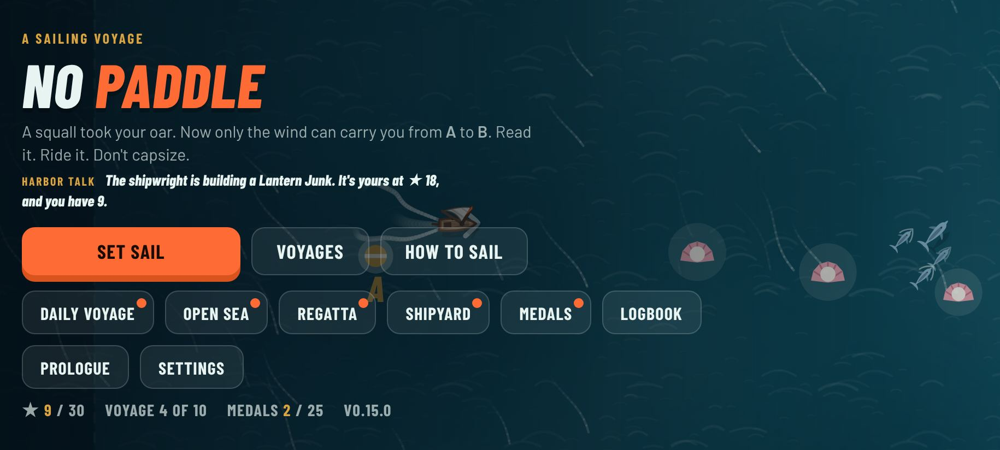
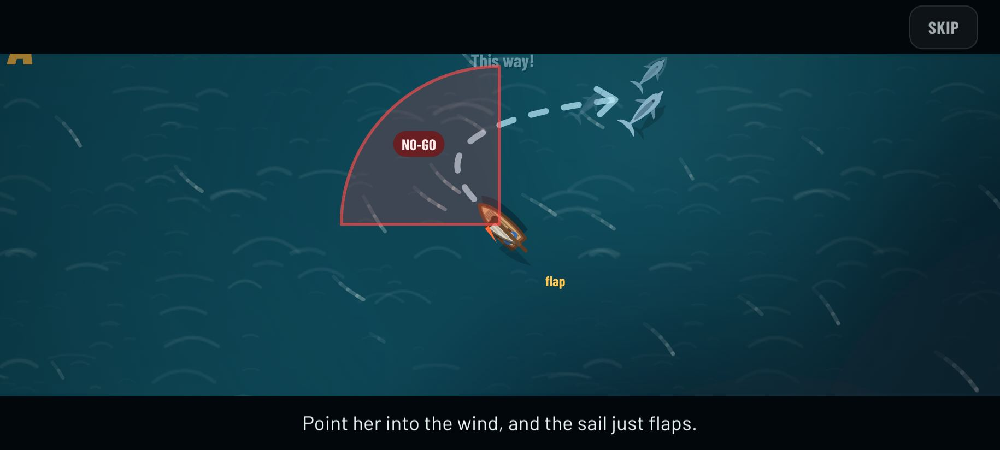
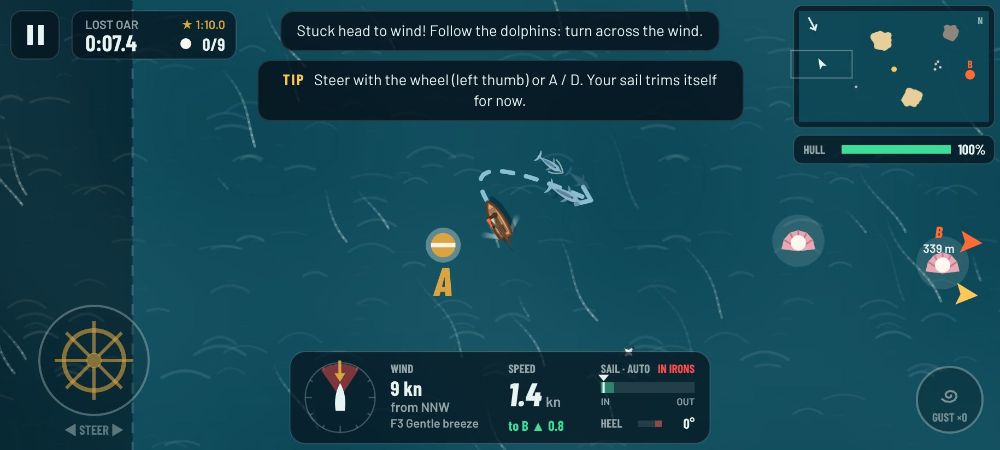
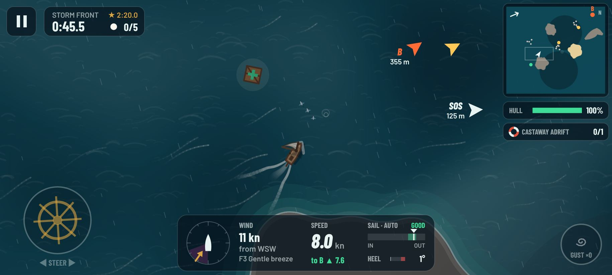

# No Paddle

A squall snapped your oar. Now only the wind can carry you from **A** to **B**.

No Paddle (first released as Boatify) is a sailing game for Android (and any modern browser). Read the wind,
pick your angle, tack upwind, ride the gusts and get to the harbor without
capsizing, sinking on a reef or getting dragged into a whirlpool.

<p>
  
  
  
  
</p>

## Download

Every version is published as a pre-release on the
[Releases page](https://github.com/manpreetgugga/boatify/releases) with a signed
APK. Download `no-paddle-vX.Y.Z.apk` on your phone, open it and allow installing
from that source. Android 8.0 or newer.

### Google Play

The store listing (text, icon, feature graphic and screenshots) is in
`fastlane/metadata/android/en-US/`, and the privacy policy is
[PRIVACY.md](PRIVACY.md). [docs/PLAY_STORE.md](docs/PLAY_STORE.md) walks
through signing up for Play Console and publishing.

## How to play

| | Touch | Keyboard |
| --- | --- | --- |
| Steer | Touch anywhere on the left and slide (a ring appears under your thumb) | A / D or ← / → |
| Gust jar | Tap the gust button | Space |
| Sheet in / out (manual trim) | Slider on the right | W / S or ↑ / ↓ |
| Pause | Pause button or back | P or Esc |
| Restart, mute, toggle trim | | R, M, T |

- **The prologue.** The first time you launch, a short film tells the story: home, a lighthouse isle where someone waits, then you far out at dawn rowing for it, a squall that takes your oar, then the wind showing what it does (head to wind the sail just flaps, until dolphins show the way across it and she flies), and last the chart home, ten voyages away, with the reefs, whirlpools, squalls and the fog in between. Home Waters is that way home: its last voyage ends there. Skip it any time, or watch it again from the title screen's Prologue button.
- **The no-go zone.** You can't sail straight into the wind. The shaded wedge on the compass shows where the sail stops working.
- **Beam reach is fastest.** Wind from the side gives the most speed; dead downwind is slower than you'd think.
- **Zig-zag upwind.** Sail about 45° off the wind, then tack through it. Keep speed up or you'll stall "in irons".
- **Watch the heel.** Gusts lean the boat over. When the little boat on the compass turns red you're close to capsizing. Ease out or bear away.
- **Follow the dolphins.** Stuck head to wind, or sailing off away from B? A few dolphins surface off the bow on the side to turn to and swim the way to go, with a line of foam curving from your bow to them. Follow them up to speed and they ride your bow wave. Turn the hint off in Settings.
- **Read the water.** Dark ruffled patches are gusts, pale glassy water is a lull or an island's wind shadow. Streaks show how the air flows.
- **Worlds.** After the ten voyages of Home Waters the campaign carries on into ten new worlds of ten voyages each, opening one after another. In the **Volcano Isles**, lava runs down smoking cones and ash falls; vents boil and then blow, pumice rafts drift on the tide, and a lava flow walls off the sea. In **Harbor City**, dock workers wave from quays stacked with containers, gantry cranes drop containers into the water, and ferries full of passengers cross your course. On **Planet Zeta**, a violet sea, you sail past crystal isles and fungus islands where eyes on stalks watch you. Giant jellies drift, gravity wells pull, the air is sometimes too thin to fill a sail, and beasts rise from below. In the **Jungle Delta**, macaws fly over the canopy, mangroves stand on their roots, hippos drift on the tide and a crocodile snaps in its pool. In **Dino Lagoon**, sauropods wade through fern isles, pterosaurs circle red cliffs, giant bones stick out of the water and a plesiosaur rises from the deep. In the **Sunken City**, you sail over drowned streets between broken columns and tower tops, galleys row across the lanes, and an eel lunges from the city gate. On the **Ghost Sea**, lanterns glow on islands of graves, ghost ships glide through the mist and a wraith bursts out of the wisps. Under the northern lights of **Aurora Ice**, polar bears prowl the glaciers, icebergs drift and an orca breaches. In **Toy Bay**, the islands are giant bricks and sandcastles, rubber ducks drift by and a jack-in-the-box springs its clown. On the **Sky Sea**, you sail among cloud banks and floating isles with waterfalls, past balloons and airships, and thunderclouds strike with lightning. The Voyages screen has a tab for each world. Finishing every voyage in a world earns its medal and a sail or hull paint.
- **Daily voyage.** After the first three voyages, a new course is charted every day: the same one for everyone that day. Sail it on consecutive days to build a streak.
- **Festival weeks.** In the week around Halloween, Diwali, Christmas and New Year the daily voyage is the festival's own, at night, with jack-o'-lanterns and bats, floating clay lamps and fireworks, snow and lit trees on the islands, or paper lanterns and fireworks. Sailing it home that week wins the festival's sail (Pumpkin, Rangoli, Candy Cane, Firework), which can't be had any other way. Weeks follow the phone's calendar; Diwali's dates are listed to 2035 (`data/festivals.js`, `render/festive.js`).
- **Your harbor.** Coins build a bare island into a harbor: a lighthouse, docks, houses and boats, fourteen pieces in four rows, some needing others first. It's drawn growing on the title screen; tap it, or open it from the Shop, to build. Each row finished pays a black pearl. What's built lives in the wallet, so backup codes carry it (`data/harbor.js`, `render/harbor.js`).
- **Harbourmaster's orders.** Once the daily voyage opens, the harbourmaster posts three small jobs a day, the same for everyone: one easy (set sail three times, collect pearls), one that asks for good sailing (three stars twice, no bumps, a best time beaten) and one that sends you somewhere (a castaway, Open Sea gates, a regatta podium, the dolphins). Each pays coins the moment it's done, and all three open the harbourmaster's chest, with a black pearl inside. One order a day can be swapped for another.
- **Reminders.** On Android, a nudge at 9 am, 6 pm and 9 pm, drawn at random from more than 150 lines (`data/reminders.js`): tips, the next voyage, a castaway adrift, today's orders. The phone is asked after the first voyage home, Settings can turn them off, and none come while the game is open or just after.
- **Share and rate.** Every results screen has a Share button for your time, stars, distance or place, with a link to the game, and Settings has **Tell a friend**. Now and then, after a three-star finish, Google Play's own box asks for a rating (`platform/social.js`).
- **Backup code.** Settings → Backup code turns the whole save into one line of text to copy, and pastes one from another phone to carry progress over, with a check that catches a code cut short or mistyped (`platform/backup.js`).
- **Open Sea.** An endless run east with no harbor at the end. Sail through buoy gates to put time back on the clock (pearls add a little more) while the wind shifts and islands, reefs, currents and whirlpools come thicker the further you go. How far can you get before the clock runs out?
- **Regatta.** Race three rival boats round two marks and into the harbor. A gold racing line shows a course you can really sail: up the beat it zig-zags, with each tack ringed, and the minimap shows it too. Round the marks in order, keep out of the dirty air in a rival's lee, and don't bump into the fleet. Win and the next race steps up from the Club fleet to the Open and then the Championship.
- **Castaways.** On every voyage after the first, someone is clinging to wreckage, waving. Turn into the wind to stop, drift alongside until the ring fills, and they climb aboard. Their weight on the rail means a little less heel and a touch less speed. Bring them home to the harbor and they're rescued, and they're written into your logbook.
- **Shipyard.** Earn stars to unlock the Reed Skiff, Twin Proa, Lantern Junk and the Grand Galleon, a three-masted ship as big as the pirate brig. Each boat trades speed, upwind ability, stability, agility and toughness differently.
- **Medals.** Thirty-five goals beyond the stars: thread a coral reef without a dent, dodge the kraken, ride with dolphins, escape the pirates without a scratch, cross the ice untouched, find every bottle, sail a week of daily voyages, win a regatta, bring every castaway home. The Medals screen shows how close you are to each one. Some are secrets: until you reach the waters they're won in, all you get is a riddle.
- **Sail Locker.** Every medal unlocks a sail design or a hull paint: the Jolly Roger, a rainbow sail, Admiral's Blue, a gilded hull and more. Royal Purple, sunset and diamond-dust sails and three more hull paints are for sale for coins. Looks only: they never change how a boat sails.
- **Coins and black pearls.** Voyages pay coins for finishing, stars, pearls, castaways, medals and the daily streak; the Open Sea pays for distance and regattas for your place. Black pearls are rare: each voyage with a whirlpool, a kraken or pirates hides one near the danger, and you keep it by finishing. In the Shop, coins buy gust jars for the hold and black pearls unlock boats early, trade for coins, or buy an Open Sea second wind. The game earns from ads only, with nothing sold for money: a video for a black pearl, a second wind or a voyage's coins twice over, and a short ad between voyages. The Android app serves them from AdMob ([docs/MONETIZATION.md](docs/MONETIZATION.md)); in a browser there are none.
- **Race your ghost.** Once you've finished a voyage, a pale ghost boat replays your fastest run, and a chip under the timer says how far ahead or behind you are. Turn it off in Settings.
- **Pirates.** On Pirate Waters a square-rigged brig hunts you. It's fast downwind but can't sail close to the wind, so reach across the wind, get upwind, or thread a reef gap too narrow for it. Dodge the cannonballs: a red ring marks where each will land.
- **Zoom.** Pinch with two fingers while sailing, or use the magnifier button at the top, to step the view from Far to Closer. The + and - keys, the mouse wheel and Settings also change it.
- **Your skipper.** A sailor in a yellow jacket sails with you. He sits at the tiller while you steer. Leave the helm alone and he wanders up the deck: to the bow to look out, to the mast, to lean on the rail, or out over the stern with a fishing line when you're going slowly. Steer and he runs back to the tiller; heel over and he sits out on the high side, ducking under the boom when you tack. He cheers every pearl and castaway, and if she capsizes he's in the water beside her. Rival boats and the Shipyard boat have a helmsman too.
- **Sea life.** Dolphins ride your bow wave and push you along if you sail fast enough. Whales spout, dive and breach, sending out a swell that rocks your boat. Flying fish skim past and gulls land on the stern when you stop. On the ice, penguins huddle on the bergs and floes; sail close and they belly-slide into the sea for a swim, while gulls wheel overhead. The islands are alive too: grass, bushes, trees and wild flowers on the green ones, moss, lichen and sea pinks on the rocks, crabs scuttling along the shore, goats and their kids grazing inland and parrots flitting between the palms. Sea turtles doze on the beaches and seals bask on the rocks; sail close and they slip into the sea and swim about until you've gone.
- **Play your way.** Settings has colour-blind friendly colours (blue and orange instead of green and red), a reduce-motion mode (no screen shake or lightning flashes; it follows your phone's setting until you choose), three text sizes, left-handed controls, steering sensitivity and the dolphin hints.

### Voyages

1. **Lost Oar**: a gentle downwind run home.
2. **Beam Reach Bay**: the fastest point of sail, between islands.
3. **Into the Wind**: home is dead upwind. Learn to tack.
4. **Coral Maze**: find the gaps in the reef walls.
5. **Whirlpool Strait**: currents and a whirlpool in a narrow channel.
6. **Wind Shadow**: tall islands steal your wind.
7. **Storm Front**: squalls, rain and lightning.
8. **Kraken Fog**: night, fog and something in the water.
9. **Drift Ice**: snow, icebergs and floes that drift across the channel.
10. **Pirate Waters**: outsail a pirate brig, or lose it in the reef.

Each voyage you haven't sailed yet has a line on its card hinting at what's out there, and the title screen passes on harbor talk about something you haven't found yet.

Finish under the gold time for three stars. Collect pearls, gust jars, repair
crates and messages in bottles along the way.

## Development

Requires Node 18+. No dependencies to install.

```sh
npm start           # play the dev build at http://localhost:5173
npm test            # the prologue film, dolphin guides, harbor talk and secret medals, physics, wind, boats, floes, pirates, levels and daily courses (the autopilot sails them), the Open Sea, regattas, castaways, medals, daily orders, reminders, sharing and doubling coins, backup codes, festival weeks, the harbor, the Sail Locker, accessibility, save and bundle tests
npm run build       # dist/index.html: the whole game in one file
npm run smoke       # browser playtest with Playwright (needs Playwright installed)
npm run store-art   # redraw the Play store icon, feature graphic and screenshots (Playwright)
```

The game is plain JavaScript modules in `web/src`:

- `physics/`: sail aerodynamics, the boat model and the Shipyard's boat types
- `world/`: game simulation, wind field, water, drifting ice, collisions, voyages, autopilot
- `render/`: canvas renderer (ocean, islands, boat, effects, lighting, HUD)
- `input/`, `audio/`, `ui/`, `platform/`: controls, WebAudio sound, menus, saves and the Android bridge
- `data/levels.js`: the voyages; `data/daily.js`: the daily course generator; `data/festivals.js` and `render/festive.js`: festival weeks and their decorations; `data/harbor.js` and `render/harbor.js`: your harbor and its pieces; `world/opensea.js`: the endless Open Sea; `world/regatta.js`: the regatta course and its fleet; `world/castaways.js`: castaways and hauling them aboard; `world/guide.js`: dolphins that show a stuck or lost sailor the way; `world/prologue.js` and `render/film.js`: the prologue film's script and camera; `data/medals.js`: the medals; `data/orders.js`: the harbourmaster's daily orders; `data/reminders.js`: the phone's reminders; `platform/social.js`: share texts and when to ask for a rating; `platform/backup.js`: backup codes; `data/rumors.js`: the title screen's harbor talk; `data/locker.js`: the Sail Locker's sails and hull paints

### Android

`android/` is a small Kotlin WebView shell. Gradle runs `scripts/build.mjs` to
bundle the game into the APK's assets, so the game works offline; only the
ads (AdMob, in `AdsBridge.kt`) use the network.

```sh
cd android
./gradlew assembleRelease   # needs the Android SDK (or let CI build it)
```

CI (`.github/workflows/build.yml`) runs the tests, builds the APK and creates a
pre-release for each new version in `package.json`, with the Play bundle
(`.aab`) when the upload key is set up. See `android/keystore/README.md` for
signing and `docs/PLAY_STORE.md` for Google Play.

## Credits

Barlow and Barlow Condensed fonts by Jeremy Tribby, SIL Open Font License
(`web/fonts/OFL.txt`). Everything else, including the sound, is generated in code.
